# Project Template

> 对应方案：《WorkerHub 通用技术方案》main 现行版（[WorkerHub/tech-scheme](https://github.com/WorkerHub/tech-scheme)）。tech-scheme 是法，本仓是法的可运行实现；方案变更后的同步是独立工作。

WorkerHub 薄骨架：迁移、setup 与鉴权的最小实现。本仓是 GitHub **template repository**，供 WorkerHub 新项目作为起点一键生成，**不是**带业务的小产品——没有示例业务表，也没有业务逻辑。

- **前端**：公开侧只有首页、登录、注册、找回密码与初始化页；登录后是「工作台 / 设置 / 关于 / 系统管理」四页骨架。
- **后端**：只做项目身份、表前缀、迁移账本、setup、鉴权（密码 + TOTP + Passkey）、注册审核、邮件验证码与系统管理接口。
- **模板例外**：本仓自身没有生产目标，`deploy.yml` 只保留 `workflow_dispatch`；从模板生成的新项目必须按下文「生成清单」改回自动部署。

## 界面预览

以下截图取自本仓的界面（中文、亮色为主，另附暗色与移动端）。公开首页只有项目名、一句话说明与登录入口；登录后是「工作台 / 设置 / 关于 / 系统管理」四页骨架；初始化页按数据库状态切换初始化、升级与已关闭三形态。

<p align="center">
  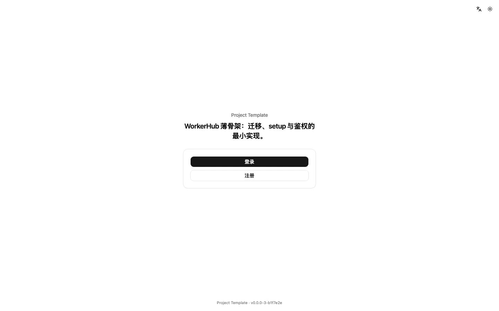
</p>

| 登录                                                                                                                                          | 两步验证                                                                                                                                              |
| --------------------------------------------------------------------------------------------------------------------------------------------- | ----------------------------------------------------------------------------------------------------------------------------------------------------- |
|  | 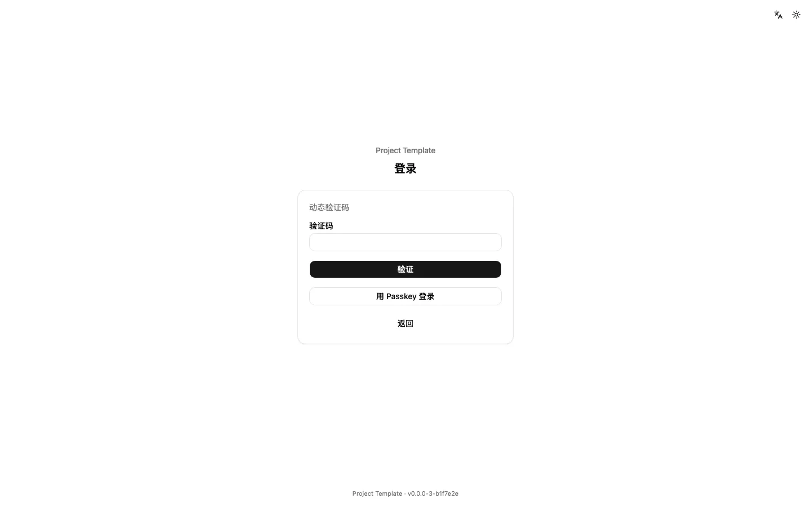 |

| 工作台                                                                                                                                          | 系统管理                                                                                                                                                                     |
| ----------------------------------------------------------------------------------------------------------------------------------------------- | ---------------------------------------------------------------------------------------------------------------------------------------------------------------------------- |
| 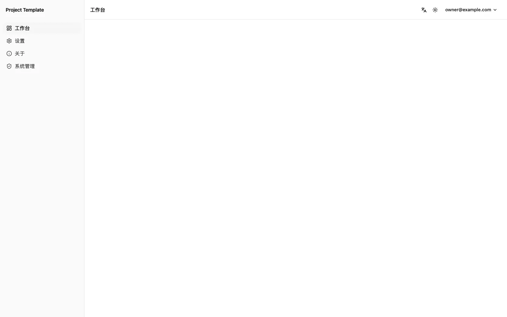 | 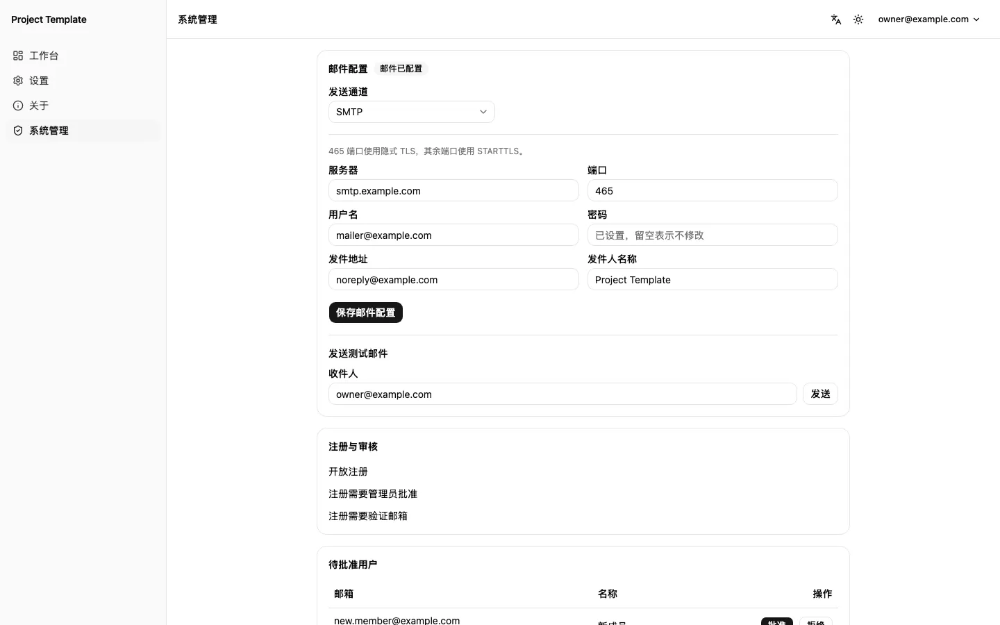 |

| 设置·个人资料                                                                                                         | 设置·偏好                                                                                                                                             |
| --------------------------------------------------------------------------------------------------------------------- | ----------------------------------------------------------------------------------------------------------------------------------------------------- |
| 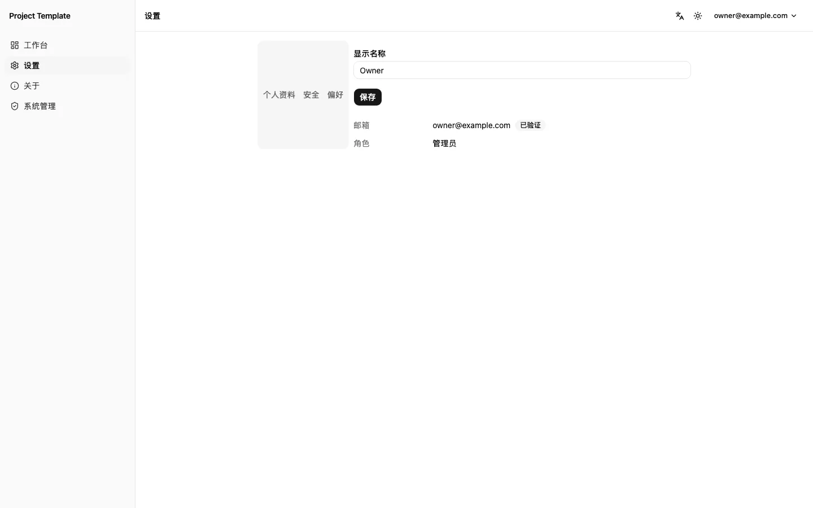 | 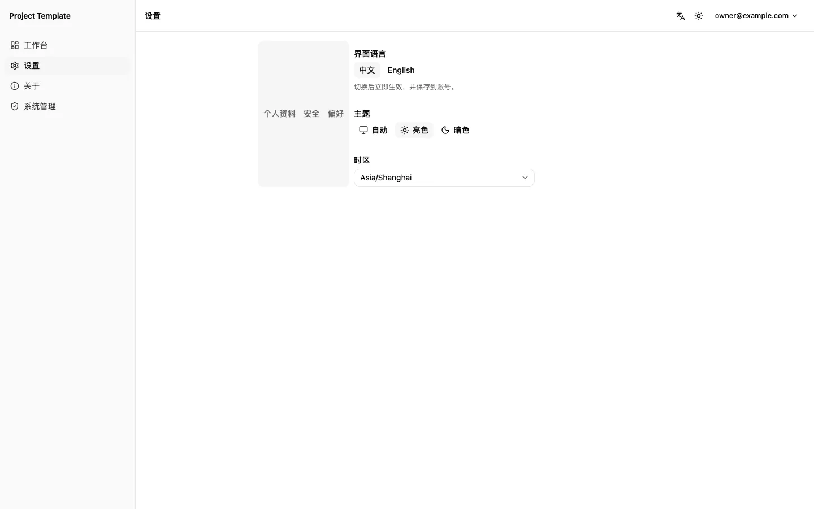 |

| 初始化                                                                                                                    | 关于                                                                                                                           |
| ------------------------------------------------------------------------------------------------------------------------- | ------------------------------------------------------------------------------------------------------------------------------ |
| 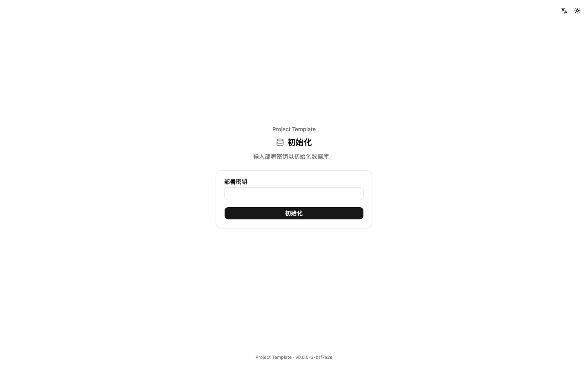 | 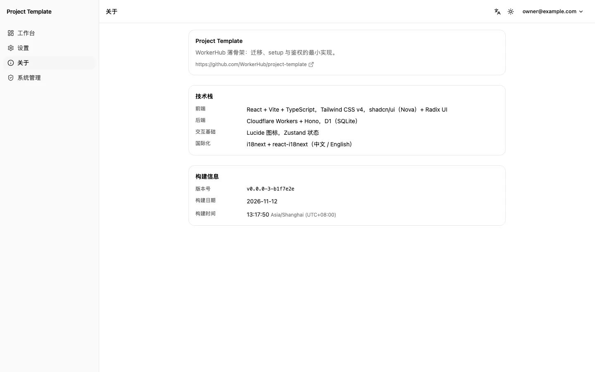 |

| 注册                                                                                                                           | 找回密码                                                                                                          |
| ------------------------------------------------------------------------------------------------------------------------------ | ----------------------------------------------------------------------------------------------------------------- |
| 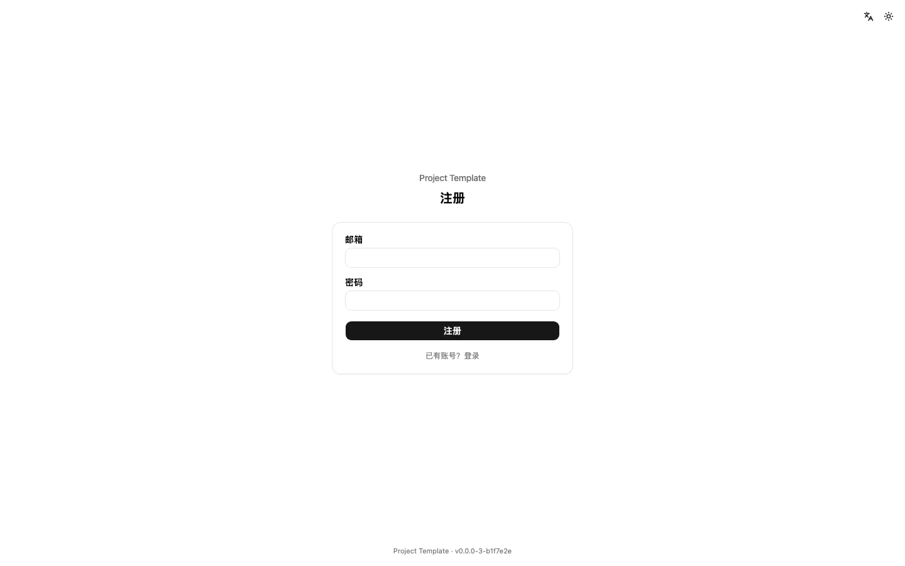 | 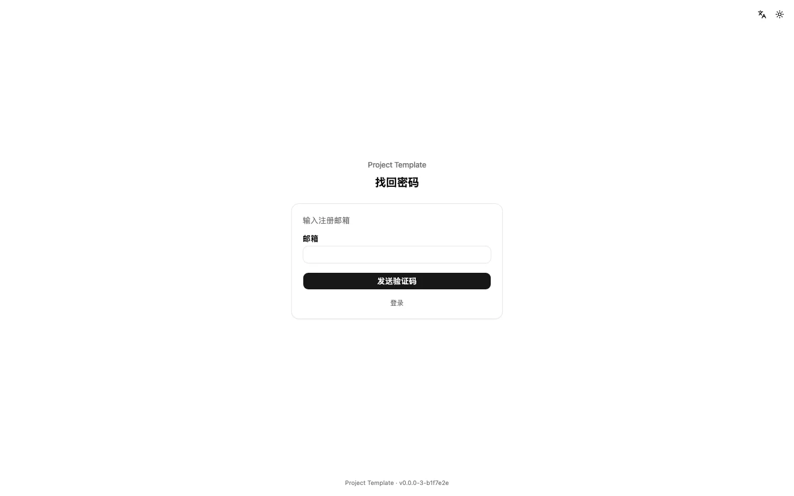 |

<p align="center">
  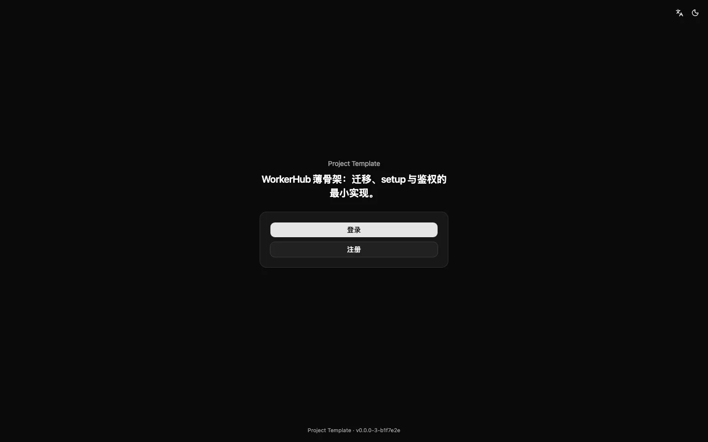
  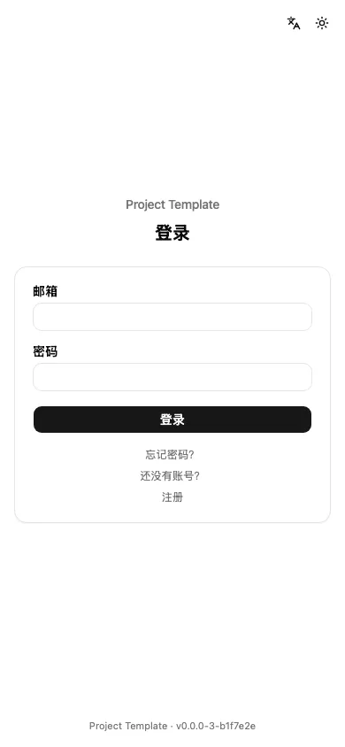
  
</p>

## 功能特性

- **项目身份单点**：`worker/src/config/project.ts` 集中放展示名、仓库 / Worker 名、一句话说明与仓库地址；默认表前缀单独放在 `worker/src/config/defaults.json`，worker 运行时与部署脚本共读这一份，改它一处两端同时生效。`pnpm check:identity` 扫描全仓，白名单外出现项目名 / slug 即失败。
- **表前缀三态**：未配置 → 默认前缀；配置自定义值 → 规范化后使用；显式空值 → 无前缀。生效前缀必须在初始化前定死，中途换前缀会被 setup 的前缀冲突守卫拦下（409）。
- **账本式迁移**：单一基线 `schema_v1`，幂等、只进不退；账本表为 `_<生效前缀>schema_migrations`。`worker/src/db/schema.sql` 与 `worker/src/lib/schema.ts` 的定义逐字同步，由测试锁住。
- **setup 双入口**：`/setup` 页（凭部署密钥）与系统管理「检查并升级数据库」（凭管理员会话）调用同一个迁移 runner；`POST /api/setup` 是纯升级端点，只跑迁移、不建用户，密钥只走 `X-Setup-Secret` 请求头（不进 URL），按 IP 限流。UI 不提供删表 / 清库入口。
- **鉴权**：邮箱密码 + TOTP（密码步与验证码步分开呈现）+ Passkey（WebAuthn）；会话 Cookie 为 `HttpOnly` + `Secure` + `SameSite=Strict`，库里只存令牌哈希；密码连续失败按账号锁定，另有按 IP 的限流。
- **注册与审核**：默认开放注册、需要管理员批准；首个注册用户自动成为管理员并直接批准。可另开「注册需验证邮箱」。
- **前端**：亮 / 暗 / 自动三档主题（首屏内联脚本防白闪）；中英双语（i18next，后端错误按稳定错误码翻译）；版本号与构建日期 / 时间由 `git describe` 在构建时生成（`build-info.json`，不入库）。
- **系统管理**：邮件配置与测试邮件、注册 / 审核开关、待批准用户批准 / 拒绝、setup 页开关、数据库维护（回显生效前缀与迁移记录）。
- **定时任务桩**：`scheduled()` 与 waker 双入口骨架，只有一个写日志的 no-op 任务与 D1 抢占示例，不碰真实业务。
- **CI/CD 四件套**：`ci.yml`（lint / format / typecheck / build / test / 身份令牌 / 部署配置 dry-run）、`deploy.yml`（手动触发）、`tag.yml`（手动打语义化版本 tag，用仓库 secret `PAT_TOKEN`）、`release.yml`（tag 触发 GitHub Release）。

## 技术栈

| 层     | 选型                                                                                                   |
| ------ | ------------------------------------------------------------------------------------------------------ |
| 前端   | React + Vite + TypeScript，Tailwind CSS v4，shadcn/ui（Nova）+ Radix UI，Lucide，Zustand，react-router |
| 后端   | Cloudflare Workers + Hono，D1（SQLite），WebAuthn（`@simplewebauthn/server`），otpauth                 |
| 国际化 | i18next + react-i18next（中文 / English），邮件模板双语                                                |
| 邮件   | `cloudflare:sockets` 原生 SMTP，或 Resend HTTPS API                                                    |
| 工程   | pnpm workspace，Biome，Vitest，Wrangler，GitHub Actions                                                |

## 目录结构

```text
.
├─ .github/
│  ├─ assets/imgs/            # README 截图（WebP，kebab 命名）
│  └─ workflows/              # ci / deploy / tag / release
├─ scripts/                   # build-info / check-identity / materialize-secrets / resolve-table-prefix
├─ web/                       # React + Vite 前端
│  └─ src/                    # pages / components/ui / lib / stores / locales
├─ worker/                    # Hono Worker
│  ├─ src/config/project.ts   # 项目身份单点
│  ├─ src/config/defaults.json # 默认表前缀（worker 与 scripts 共读）
│  ├─ src/db/schema.sql       # 与 src/lib/schema.ts 逐字同步
│  ├─ src/lib/                # 表前缀、迁移 runner、setup、设置
│  ├─ src/core/               # 鉴权、会话、验证码、限流、waker 开关
│  ├─ src/services/           # 邮件（SMTP / Resend）、定时任务桩
│  ├─ src/routes/             # auth / 2fa / setup / admin / me / public / waker
│  └─ test/                   # vitest（真实 SQLite 内存库跑迁移与接口契约）
├─ biome.json
├─ package.json
├─ pnpm-workspace.yaml
└─ tsconfig.base.json
```

## 本地开发

前置：Node（版本要求见根 `package.json` 的 `engines`）与 pnpm（见 `packageManager`）。

```bash
pnpm install
cp worker/.dev.vars.example worker/.dev.vars   # 填 SETUP_SECRET / SIGNING_SECRET
pnpm dev
```

`.dev.vars` 里两把密钥分别生成、不得复用：

```bash
openssl rand -base64 32   # SETUP_SECRET
openssl rand -base64 32   # SIGNING_SECRET
```

- `SETUP_SECRET`：setup 页与 `POST /api/setup` 的 `X-Setup-Secret`。缺失、为空或仍是 `*_PLACEHOLDER` 时，setup 接口 500 失败关闭。
- `SIGNING_SECRET`：两步登录 tempToken、Passkey 挑战 Cookie、邮件验证码哈希的签名钥。缺失时这些端点 500 失败关闭，其余功能不受影响。
- `TABLE_PREFIX` 可选：不写 → 默认前缀；写空值 → 无前缀；其他值 → 规范化后使用。本地不要写 CI 侧的保留字 `none`。
- `WAKER_SIGNING_KEY` 可选，见「定时任务与 waker」。

`pnpm dev` 先构建一次前端，再同时起 worker（`wrangler dev`，默认 8787）与 Vite（`/api` 反代到 8787）。也可以分开跑：单独跑 `pnpm dev:web`；单独跑 `pnpm dev:worker` 前要先 `pnpm build:web`——wrangler 直接托管 `web/dist`，目录不存在会启动失败。

### 首次初始化

1. 打开 `/setup`，输入 `.dev.vars` 里的 `SETUP_SECRET`，点「初始化」：跑迁移，回显生效表前缀与迁移记录。
2. 点「注册首个用户」（或打开 `/register`）建账号：首个用户自动成为管理员并直接批准。
3. 之后 setup 页默认关闭；管理员可在「系统管理 → 数据库维护」重开页面或再次执行迁移。`/setup` 的「检查并升级」与 `POST /api/setup` 都只跑迁移，不会建用户、改密码或删数据。

初始化也可以直接用 curl（把 `<SETUP_SECRET>` 换成 `.dev.vars` 里的值，密钥只放请求头）：

```bash
curl -X POST http://127.0.0.1:8787/api/setup \
  -H "X-Setup-Secret: <SETUP_SECRET>"
```

本地数据只存在本机 D1（`worker/.wrangler/state`）。模板不带示例业务数据；要清空本地库（含验收账号与设置）：

```bash
rm -rf worker/.wrangler/state
```

## 测试与校验

```bash
pnpm lint           # Biome 代码检查
pnpm format:check   # Biome 格式检查，不改文件；要自动重排跑 pnpm format
pnpm typecheck      # web + worker 类型检查
pnpm test           # worker 与 web 单测（vitest）
pnpm build          # 前端产物 + worker 类型构建
pnpm check:identity # 项目身份令牌校验（白名单外零残留）
pnpm check:deploy   # 先 build:web，再 wrangler deploy --dry-run（不联网、不写线上资源）
```

`.github/workflows/ci.yml` 在 PR 与 main push 上逐条跑这些检查。

## 邮件与验证码

- 在「系统管理 → 邮件配置」里三选一：`none`（默认，未配置）/ `smtp` / `resend`。同一时刻只有一个生效，不做双通道或自动故障转移。
- SMTP 走 `cloudflare:sockets`：465 端口隐式 TLS，其余端口 STARTTLS；服务器不支持 STARTTLS 却配了账号密码时拒绝发送。Resend 走 HTTPS API，错误原文回显在测试邮件结果里。
- 凭据只写不读：接口只回「已设置 / 尚未设置」，保存时留空表示不改。
- 「邮件是否可用」只有一个判断：provider 为 `none`、SMTP 缺 host 或 Resend 缺 API key 都算未配置。未配置时登录页不显示「忘记密码？」，「注册需验证邮箱」不能开启（前端置灰、后端拒绝）；开关已开后渠道被清空时按未配置处理，不会把新注册用户锁死。
- 验证码：6 位数字、只存哈希、10 分钟有效、单个验证码最多试 5 次、用后即废、60 秒重发冷却，按邮箱与 IP 双限流；邮件按收件账号语言（找回密码按请求语言）发中英双语模板。

## 定时任务与 waker

- `worker/wrangler.toml` 的 `[triggers] crons` 是唯一的原生定时入口（模板里是每天一次）；任务本身只有一个 no-op 日志与 D1 抢占示例，生成项目后往里加自己的 job。
- 触发方式只由 `WAKER_SIGNING_KEY` 一个变量的取值决定，没有第二个模式开关：
  - 未配置（含空值、`*_PLACEHOLDER`）→ 原生 Cron 跑；
  - `false`（小写，保留值）→ 两个入口都不跑；
  - 配了 waker 给的 key → waker 回调接管（`/_waker/execute` 验签），Cron 入口自行跳过。
- 接入 waker 只配这一把 GitHub Secret。要彻底停掉原生 Cron 时把 `crons` 显式置为 `[]`，不要整段删除 `[triggers]`（Cloudflare 会保留已有 cron）。

## 密钥与数据

- 仓库里只有占位符与键名：`worker/wrangler.toml` 不含真实 ID，`.dev.vars` 与 `build-info.json` 已 gitignore，README 不写任何密钥值。
- 线上密钥只走 GitHub Secrets：部署时 `scripts/materialize-secrets.mjs` 把它们写进 `$RUNNER_TEMP/secrets.json`（权限 0600），再经 `wrangler deploy --secrets-file` 上传；脚本只打印键名，不打印值。
- 模板不含示例业务表与种子数据；验收 / 截图用的账号只在本机 D1，清空方式见「本地开发」。

## 部署

### 模板仓的例外

本仓没有生产目标：`deploy.yml` 只接受手动触发（`workflow_dispatch`），团队不会运行它。生成新项目后必须按「生成清单」第 6 步改回「push main 触发自动部署」，**不要保留模板的这一例外**。

### 凭证清单

凭证与变量只从 GitHub Secrets / Variables 读取，绝不写进仓库：

| 名称                    | 放哪          | 必填 | 用途                                                                   |
| ----------------------- | ------------- | ---- | ---------------------------------------------------------------------- |
| `SETUP_SECRET`          | 仓库 secret   | 是   | setup 页与 `POST /api/setup` 的 `X-Setup-Secret`，上传为 Worker secret |
| `SIGNING_SECRET`        | 仓库 secret   | 是   | tempToken / Passkey 挑战 / 验证码哈希签名，上传为 Worker secret        |
| `CLOUDFLARE_API_TOKEN`  | 组织 secret   | 是   | wrangler 部署                                                          |
| `CLOUDFLARE_ACCOUNT_ID` | 组织 secret   | 是   | Cloudflare 账户                                                        |
| `D1_DATABASE_ID`        | 组织 secret   | 是   | 共享 D1 的库 ID                                                        |
| `D1_DATABASE_NAME`      | 组织 variable | 是   | 共享 D1 的库名，替换 `wrangler.toml` 占位符                            |
| `TABLE_PREFIX`          | variable      | 否   | 表前缀三态（见下）                                                     |
| `WAKER_SIGNING_KEY`     | 仓库 secret   | 否   | waker 回调验签钥                                                       |

- 舰队项目复用组织级 secret 与同一个共享 D1：不建仓库级同名项、不新建库；仓库级只加 `SETUP_SECRET` / `SIGNING_SECRET`（`WAKER_SIGNING_KEY` 按需）。
- `tag.yml` 推 tag 还用到仓库 secret `PAT_TOKEN`（有 repo 写权限的 PAT）；不手动打 tag 的项目可以不配。
- `SETUP_SECRET` 与 `SIGNING_SECRET` 在同一层级必填：`scripts/materialize-secrets.mjs` 逐项校验，缺任一把、为空或仍是占位值就退出 1 并点名，**不生成 secrets.json、也不改动 wrangler.toml**。
- `TABLE_PREFIX` 三态：未配置 / 空 → 项目默认前缀（`worker/src/config/defaults.json`，运行时补尾下划线）；CI 保留字 `none` → 无前缀；其他值 → 校验后原样注入。生效前缀必须在初始化前定死，初始化后换前缀会被前缀冲突守卫拦下。

### 部署流程

1. 触发器：模板仓只有手动 `workflow_dispatch`（团队不运行），生成的项目按「生成清单」第 6 步改为 push main 触发自动部署。
2. `deploy.yml` 依次：安装依赖 → `materialize-secrets`（校验、写 secrets.json、解析 wrangler.toml）→ 构建前端 → `wrangler deploy --secrets-file`。
3. 部署本身不跑迁移。部署完成后打开 `/setup` 用部署密钥跑一次迁移（或由管理员在「系统管理 → 数据库维护」点「检查并升级数据库」）。

## 从本模板生成新项目（生成清单）

按顺序做完，第 4 步通过才算改名完成。

1. **建仓**：在 GitHub 上「Use this template」→ Create a new repository（public）。仓库设置里的 Template repository 只属于模板仓。
2. **改身份单点**（`worker/src/config/project.ts` + `worker/src/config/defaults.json`）：
   - `PROJECT_NAME`：展示名；`PROJECT_SLUG`：仓库名 / Worker 名；
   - `PROJECT_TAGLINE`：一句话说明（首页与「关于」页）；
   - `DEFAULT_TABLE_PREFIX`：默认表前缀，在 **`worker/src/config/defaults.json` 的 `defaultTablePrefix`** 改（不含尾下划线；初始化前定死，之后不可改）——worker 运行时与部署脚本读同一份，只改这一处；
   - `PROJECT_REPOSITORY_URL`：新仓地址；
   - `APP_MODE`：默认 `multi`（多用户、开放注册）；改 `single` 则是单人档（注册关闭，setup 页创建唯一所有者）。
3. **改令牌位置**（除这些位置外，全仓不得再出现旧项目名 / slug）：

   | 文件                              | 改成                                 |
   | --------------------------------- | ------------------------------------ |
   | `worker/src/config/project.ts`    | 上一步的常量                         |
   | `worker/src/config/defaults.json` | `defaultTablePrefix`（默认表前缀）   |
   | `package.json`                    | `"name": "<slug>"`                   |
   | `web/package.json`                | `"name": "<slug>-web"`               |
   | `worker/wrangler.toml`            | `name = "<slug>"`                    |
   | `web/index.html`                  | `<title><PROJECT_NAME></title>`      |
   | `README.md`                       | 标题与一句话说明（本文件最上面两段） |

4. **跑身份校验**：

   ```bash
   pnpm check:identity
   ```

   `scripts/check-identity.mjs` 检查上面这些位置是否与身份单点一致（README 只要求出现当前项目名），并扫描全仓（已跟踪 + 未跟踪但未忽略的文件，二进制跳过）：白名单外出现旧项目名或 slug 即失败并点名行号。输出「白名单外零残留」才算改名完成。

5. **配凭证**：按「部署 → 凭证清单」设好 Secrets / Variables；`SETUP_SECRET` 与 `SIGNING_SECRET` 同级必填，`TABLE_PREFIX` 按项目定。

6. **改回自动部署**：把 `.github/workflows/deploy.yml` 的 `on:` 从模板仓的「仅手动」改为 push main 触发自动部署，并删除模板仓专属的手动触发例外（规格 §8）。生成的项目不得保留这一例外：

   ```yaml
   on:
     push:
       branches: [main]
   ```

7. **首次部署与初始化**：把项目推到 `main`，等 `Deploy` 跑完，再打开 `/setup` 用部署密钥跑迁移，然后注册首个用户（自动成为管理员并批准）。初始化完成后 setup 页会自动关闭；需要再开时由管理员在「系统管理 → 数据库维护」打开。

8. **收尾**：域名在项目自己的规格里定（模板不写域名）；把 `.github/assets/imgs/` 的截图换成本项目界面（同名覆盖）并同步「界面预览」；方案版本标注随方案同步更新；CI 全绿。
